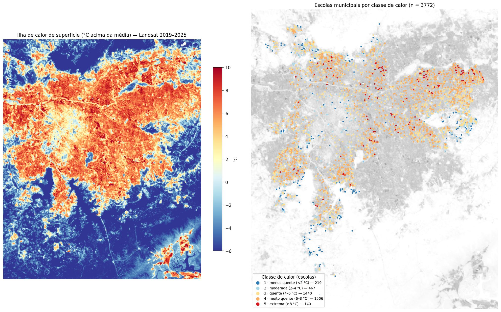
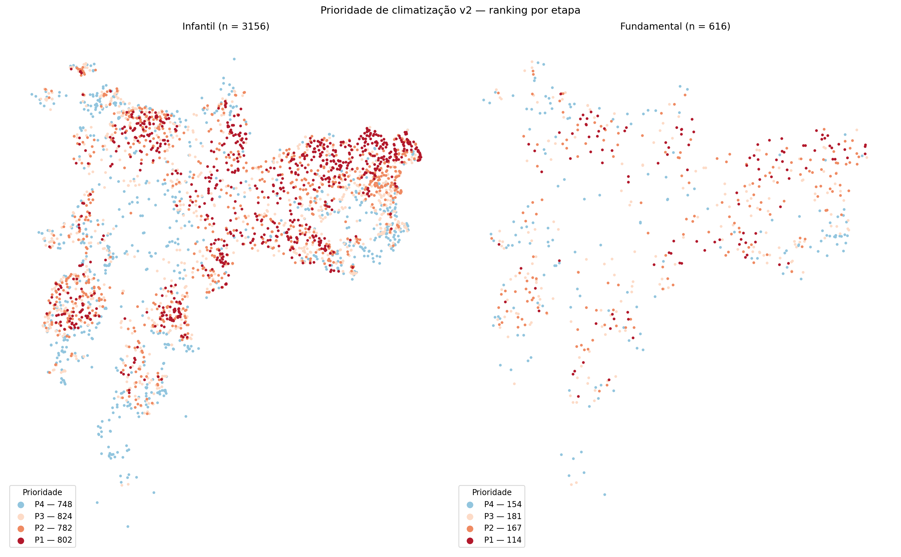

# Calor nas escolas municipais de São Paulo

[](https://github.com/micadw/escolas-calor-sp/actions/workflows/testes.yml)
[](https://doi.org/10.5281/zenodo.24401164)

**Exposição térmica de 3.772 escolas da rede municipal (Educação Infantil e Ensino Fundamental, direta e conveniada) a partir de imagens de satélite, com proposta de priorização para climatização, telhados frios e arborização.**



> Desenvolvido com dados abertos. Não representa posição oficial da Prefeitura de São Paulo nem de nenhum de seus órgãos.

## Resumo

O projeto mede o calor no entorno de cada escola municipal com imagens de satélite (Landsat 8/9) e dados de estações meteorológicas (INMET). São calculadas temperaturas de superfície, ilha de calor, sensação térmica e horas de desconforto no horário de aula, cruzadas com a idade dos alunos, as matrículas, o período integral e a vegetação do entorno. O resultado é uma classificação das escolas em cinco classes de calor e quatro níveis de prioridade (P1–P4) por etapa de ensino.

**Palavras-chave:** sensoriamento remoto · Landsat · ilha de calor urbana · temperatura de superfície (LST) · conforto térmico · análise espacial · priorização · políticas públicas · educação · Python

## Principais resultados

| Classe de calor (ilha de calor de superfície média) | Escolas |
|---|---|
| 1 · menos quente (< 2 °C) | 219 |
| 2 · moderada (2–4 °C) | 467 |
| 3 · quente (4–6 °C) | 1.440 |
| 4 · muito quente (6–8 °C) | 1.506 |
| 5 · extrema (≥ 8 °C) | 140 |

- As Diretorias Regionais de Educação mais quentes são **São Miguel** (6,8 °C de ilha de calor média; 79% das escolas nas classes 4–5), **Penha** (6,4 °C) e **Freguesia/Brasilândia** (5,9 °C).
- As mais frescas são **Capela do Socorro** (4,1 °C) e **Butantã** (4,3 °C).
- Priorização v2: **Infantil** 802 P1 / 782 P2 / 824 P3 / 748 P4; **Fundamental** 114 P1 / 167 P2 / 181 P3 / 154 P4.



## Método em uma página

1. **Escolas:** cadastro da SME (Dados Abertos PMSP), rede direta + conveniada, ativas, com coordenadas.
2. **Temperatura de superfície:** Landsat 8/9 Collection 2 Nível 2 (banda termal), máscara de nuvens, meses letivos quentes de 2019–2025 (Microsoft Planetary Computer; versão alternativa no Google Earth Engine).
3. **Cruzamento escola × pixel:** estatística zonal com peso pela fração de cada pixel de 30 m dentro de um raio de 100 m (`exactextract`). Sensibilidade testada com raios de 50, 150 e 250 m (correlação de Spearman com o raio de 100 m: 0,99; 0,99; 0,92).
4. **Ar e sensação térmica:** série horária do INMET (Mirante de Santana e Interlagos) + diferença local derivada do satélite; Heat Index (NOAA), índice de desconforto de Thom e graus-hora acima de 26 °C, só em horas letivas.
5. **Vulnerabilidade:** matrículas, faixa etária e período integral reais (Perfil das turmas, SME, jun/2026).
6. **Priorização:** posição percentil dos indicadores → sub-índices de exposição (0,60), sensibilidade (0,15) e capacidade adaptativa/vegetação (0,25) → quebras naturais por etapa; robustez com 1.000 simulações de pesos.

Detalhes em [`docs/metodologia.md`](docs/metodologia.md).

## Como reproduzir

Os notebooks rodam no Google Colab e baixam os dados das fontes oficiais.

| Ordem | Notebook | Faz |
|---|---|---|
| 1 | `notebooks/01_ingestao_escolas.ipynb` | cadastro de escolas, filtros, raios |
| 2 | `notebooks/02b_lst_landsat_planetary.ipynb` (ou `02_lst_landsat_gee_v2`) | temperatura de superfície e vegetação |
| 3 | `notebooks/03_estatistica_zonal.ipynb` | cruzamento escola × pixel |
| 4 | `notebooks/04_clima_indices_conforto.ipynb` | ar, sensação térmica, índices |
| 5 | `notebooks/05_vulnerabilidade.ipynb` | sensibilidade e vegetação |
| 6 | `notebooks/06_priorizacao_excel.ipynb` + `src/v2_ranking_e_temperatura.py` | score, categorias, planilhas e mapas |

```
.
├── data/          # não versionado — ver "Dados"
├── docs/          # metodologia
├── figures/       # mapas finais
├── notebooks/     # pipeline 01 → 06
├── outputs/       # resultados leves (CSV por escola)
├── src/           # funções e scripts
└── requirements.txt
```

## Qualidade e testes

A cada envio, o GitHub roda automaticamente (`.github/workflows/testes.yml`):

- **linter** (`ruff`) em scripts e notebooks — sintaxe, nomes indefinidos, imports sem uso;
- **testes das fórmulas** (`tests/test_indices.py`) — Heat Index contra a tabela da NOAA, índice de Thom, graus-hora, normalização;
- **testes de integridade da base** (`tests/test_dados.py`) — 3.772 escolas com código único, sem vazios nas colunas-chave, coordenadas dentro do município, faixas físicas plausíveis, classe de calor coerente com a ilha de calor, P1–P4 em cada etapa, as duas bases publicadas idênticas entre si e os números deste README iguais aos da base.

Para rodar localmente: `pip install pandas numpy pytest ruff && ruff check . && pytest`.

## Dados

- **Base por escola para planilha:** [`outputs/escolas_calor_sp_v2.xlsx`](outputs/escolas_calor_sp_v2.xlsx) (Excel, com leia-me, resumos por DRE e dicionário) e [`outputs/escolas_calor_sp_v2.csv`](outputs/escolas_calor_sp_v2.csv) (separador `;`, decimal `,`).
- **Resultados por escola:** [`outputs/escolas_temperatura.csv`](outputs/escolas_temperatura.csv) (classe de calor, ilha de calor, temperatura p90, horas com sensação ≥ 32 °C, vegetação, prioridade).
- **Versão arquivada (v2.0.0):** código e planilhas no Zenodo, DOI [10.5281/zenodo.24401164](https://doi.org/10.5281/zenodo.24401164) (aponta sempre para a versão mais recente; a v2.0.0 é [10.5281/zenodo.24401165](https://doi.org/10.5281/zenodo.24401165)). Os compostos Landsat em GeoTIFF não entram no pacote por tamanho; podem ser refeitos pelos notebooks.
- **Fontes:** [Dados Abertos PMSP / SME](https://dados.prefeitura.sp.gov.br), [USGS Landsat Collection 2](https://www.usgs.gov/landsat-missions/landsat-collection-2) via [Planetary Computer](https://planetarycomputer.microsoft.com), [INMET](https://portal.inmet.gov.br/dadoshistoricos).

## Limitações

- A temperatura de superfície mede telhados e pavimentos, não o interior das salas; é um indicador de exposição externa.
- A ilha de calor é medida em relação à média de toda a área da imagem, que inclui as matas do extremo sul — por isso quase todas as escolas ficam acima de zero.
- A temperatura do ar é estimada com apenas duas estações; os valores servem para comparar escolas, não como medição exata.

## Licença e citação

Código sob [MIT](LICENSE). Dados derivados, figuras e textos sob [CC BY 4.0](LICENSE-DATA.md). Para citar, use o arquivo [`CITATION.cff`](CITATION.cff) (botão "Cite this repository" no GitHub).

---

## English summary

**Heat exposure in São Paulo's municipal schools.** Land surface temperature from Landsat 8/9 (2019–2025) was attributed to 3,772 municipal pre-schools and primary schools with fractional-pixel zonal statistics (100 m buffers), combined with hourly INMET weather data, heat indices during school hours, enrolment, pupils' age and surrounding vegetation. Output: five heat classes and a P1–P4 priority ranking per school stage for air conditioning, cool roofs and tree planting. Built with open data only; does not represent an official position of the City of São Paulo.
